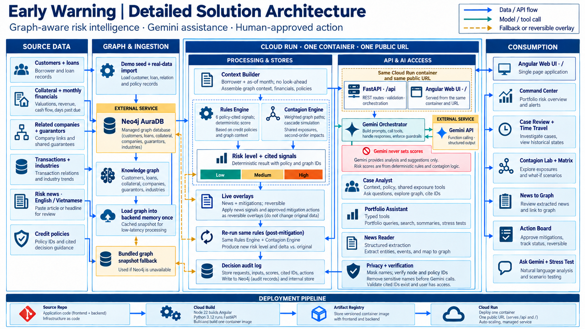
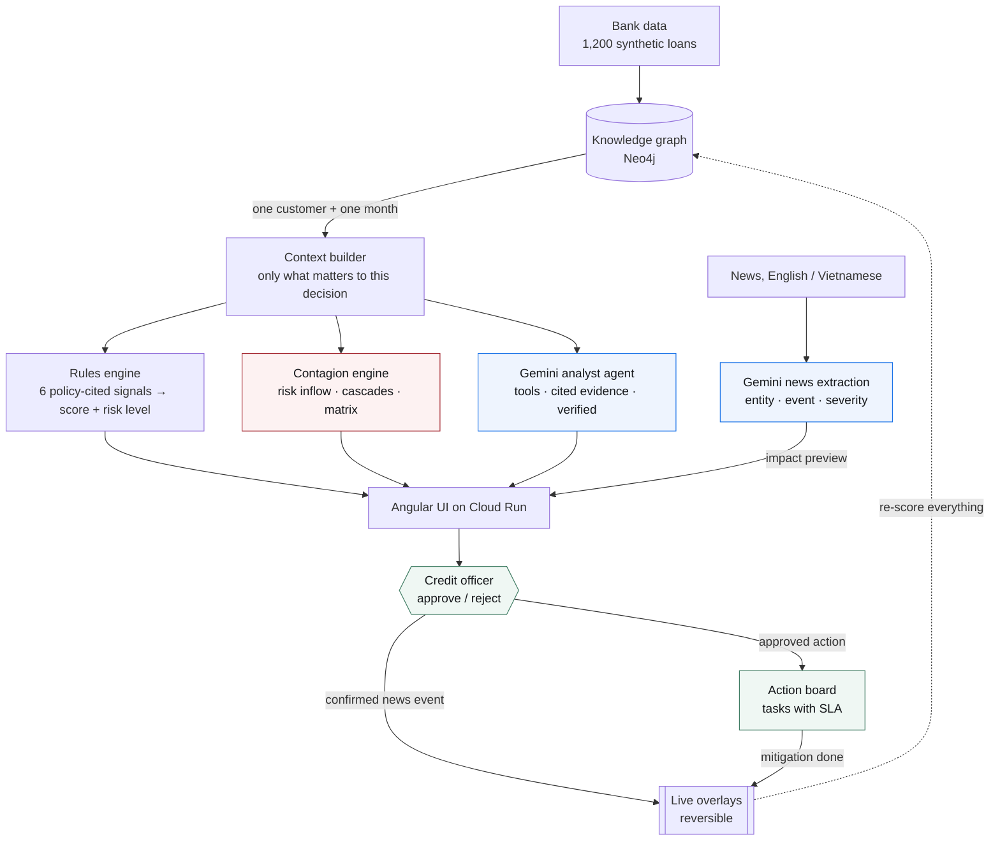

# Early Warning: Graph-Aware Early Detection of Non-Performing Loans

> Google Cloud AI Builder Cup 2026 · Track: **BFSI (Intelligent Risk, Fraud & Financial Experiences)** · Team **EWS - GDG Hanoi**

| | |
|---|---|
| 🌐 **Live prototype** | <https://early-warning-420247575616.asia-southeast1.run.app> |
| 🎬 **Demo video** | [Google Drive](https://drive.google.com/file/d/1InDYW293xSuaFpzNTwimwzQQpNzx2vnQ/view?usp=drive_link) |
| 📑 **Pitch deck** | [EWS - GDG Hanoi _ AI Builder Cup.pdf](EWS%20-%20GDG%20Hanoi%20_%20AI%20Builder%20Cup.pdf) |
| 💻 **Source code** | <https://github.com/Hu2Hoang/EWS> |

The prototype runs on synthetic data (1,200 loans). No login is needed. Start with **Case review → Customer A**, then
click any node and choose *Simulate … defaulting*.

## The Problem

Banks only flag a loan as bad once it is **30 days past due**, which is too late to act. And they cannot see how one
borrower's failure **spreads** to the related companies, guarantors and partners around it.

## The Solution

**Early Warning** watches a knowledge graph of the loan book and runs one closed loop:

**Detect → Explain → Simulate contagion → React to news → Act and measure**

- **Detect:** transparent, policy-cited rules score every loan for any month, months before the 30-day rule fires.
- **Explain:** a Gemini agent explains each alert, citing graph nodes and policies. Every claim is verified, and Gemini never sets a score.
- **Simulate:** click any counterparty to make it default and watch the risk cascade through the graph, wave by wave, with domino defaults.
- **React:** Gemini reads news in English or Vietnamese, extracts risk events and links them to graph nodes. The officer confirms them, and the portfolio is re-scored.
- **Act:** approved actions become tasks with deadlines. Completing one applies the mitigation, and the same rules measure its effect.



## Features

| View | What it does |
|---|---|
| **Command Center** | Portfolio KPIs, risk mix over time with a *Play timeline* button (early warnings vs. the legacy rule), industry heatmap, loans that newly turned High risk |
| **Case Review** | One loan: knowledge graph with its decision context lit up, a time-travel slider, rule signals with policies, Gemini analysis with cited evidence, approve / reject, action plan, audit log |
| **Contagion Lab** | Default any company, guarantor or borrower and watch the cascade. Borrowers pushed over the default threshold fall in the next round. Sliders for contagion strength, path length and threshold |
| **Contagion Matrix** | Which sources spread risk into which industry today. Click a cell to see who receives it |
| **News to Graph** | Gemini extracts entity, event type and severity from a headline, links it to a graph node and previews the impact. Apply or dismiss; every applied event can be undone. *Play news feed* streams sample headlines |
| **Action Board** | Kanban of tasks with SLAs (drag and drop). *Done* applies the mitigation (collateral top-up, ring-fencing a failing partner, loan rescheduling) and shows score, level and contagion before vs. after |
| **Stress Test** | Industry downturn, related-company failure or collateral shock on a copy of the portfolio, re-scored by the same rules |
| **Ask Gemini** | Chat with the portfolio. Gemini answers by calling typed tools and links every answer to cases |

## How It Works



### Google Services

| Service | How it is used |
|---|---|
| **Gemini API** (`google-genai`) | **Case analyst agent:** function calling over context, policy and shared-exposure tools, then schema-constrained JSON. Every cited node id and policy id is verified against the graph. **Portfolio assistant:** multi-turn function calling over typed tools. **News to graph:** structured extraction from English or Vietnamese text; names are masked into tokens first, and the tokens double as exact entity links |
| **Cloud Run** | One service hosts the Angular UI at `/` and the FastAPI API at `/api`, with one warm instance |
| **Cloud Build + Artifact Registry** | `gcloud run deploy --source .` builds the multi-stage Dockerfile and stores the image |

### Design Principles

- **The LLM never scores.** Signals, score and risk level come from deterministic rules. Gemini only explains and proposes.
- **Every claim is traceable.** Each finding cites graph node ids and a policy id. The backend checks both exist and strips anything that does not.
- **Human in the loop.** Actions are proposals. Every approval and rejection goes into an audit log.
- **Closed loop, reversible.** Confirmed news events and completed mitigations are live overlays on top of the loaded data
  (`backend/app/overlays.py`). Neo4j is never modified, every overlay can be undone, and `POST /api/live/reset` restores the loaded data.
- **PII stays home.** Names of customers, related companies and guarantors are replaced by tokens before any text goes
  to Gemini, and restored in the answer (`backend/app/privacy.py`).
- **Graceful degradation.** If Gemini fails, the API returns a rule-generated explanation and a keyword news extractor. If Neo4j fails, it serves a saved graph snapshot.

## Results

### Detection Quality (Backtest on Synthetic Data)

1,200 loans: 73 defaulters, 96 designed as legacy-rule false alarms, 72 stressed and recovered, 959 healthy.

| | Early Warning | Legacy rule (DPD ≥ 30) |
|---|---|---|
| Defaulters caught | 73 / 73 | 73 / 73 |
| Average warning before default | **120 days** | 61 days |
| False positives | **14** | 96 |
| Precision | **0.84** | 0.43 |

> The data and the thresholds were designed together, so these numbers show the mechanism working. They are **not**
> evidence of real-world performance; a real deployment needs backtesting on historical bank data.

### Response Times

Measured on the full 1,200-loan graph (median, developer machine):

| Operation | Time |
|---|---|
| Context graph + rule signals for one loan | 2 ms |
| Re-score the whole portfolio | 49 ms |
| Stress test | 55 ms |
| Default cascade simulation | 0.37 s |
| Complete a task (apply the mitigation, re-score everyone) | 86 ms |
| Gemini news → graph event (with impact preview) | 1.4 s |
| Gemini portfolio assistant | 3.1 s |
| Gemini case analysis, fresh / cached | 5.1 s / 4 ms |

## Demo Scenario

**Customer A** (Seafood, SME) deteriorates quietly over 2026:

| Month | Event |
|---|---|
| Jan 2026 | Seafood industry enters a downturn |
| Feb to Apr | Revenue falls about 35%. Apr: **Medium** (2 signals); related company An Phat Garment becomes past due |
| May 2026 | Collateral revalued, down 10%. **Early Warning fires: High, 5 signals** |
| Jul 2026 | Legacy rule (DPD ≥ 30) finally flags the loan |
| Sep 2026 | Default |

In May, defaulting An Phat Garment in the Contagion Lab hits 8 borrowers and puts 4 newly on watch. On the Action Board,
restoring the collateral takes Customer A's score from 80 to 65, and ring-fencing An Phat takes it to 50 and halves the
contagion inflow. The loan stays High, because its sales are still falling.

### Early-Warning Signals

| Signal | Fires when | Policy |
|---|---|---|
| Revenue drop | 3-month average revenue is down 15% or more vs. the baseline | P-17 |
| Negative cash flow | Net cash flow is negative for 2 consecutive periods | P-17 |
| Related company past due | Any related company is past due | P-31 |
| Collateral decline | Collateral is 9% or more below the peak of the last 6 valuations | P-22 |
| Days past due | The loan is 10 or more days past due (extra weight at 30+) | P-08 |
| Industry downturn | Industry growth is at or below -3% for 2 consecutive months | P-17 |

Risk level (P-17): **3+ signals = High**, 2 = Medium, otherwise Low.

### Contagion Model

Risk reaching borrower *i* = the sum, over non-backtracking paths of up to *h* hops, of
`α^length × relation weight × share × own risk of the source`. The relation weights are related company 0.6,
guarantor 0.5, transaction 0.4 and industry 0.15. A relation only counts from its start month, so the model never
looks ahead. In a cascade, the shocked nodes default, and a borrower pushed from below the default threshold to above
it defaults in the next round (up to 4 rounds).

## Tech Stack

| Layer | Technology |
|---|---|
| Knowledge graph | Neo4j AuraDB (Cypher) |
| Backend | Python 3.12, FastAPI |
| AI | Gemini API via `google-genai` (default `gemini-3.1-flash-lite`): function calling, structured output |
| Frontend | Angular (standalone components, signals), Cytoscape.js |
| Hosting | Google Cloud Run, Cloud Build, Artifact Registry |

## Project Structure

```
backend/app/
  repository.py    Loads the graph into memory once, then applies the live overlays
  scoring.py       Signals, score, risk level (rules only)
  context.py       Context builder: the decision-scoped subgraph for a customer and month
  contagion.py     Contagion engine: risk inflow over graph paths, default cascades, contagion matrix
  agent.py         Gemini case analyst: tool loop, schema output, verification, fallback, cache
  chat.py          Gemini portfolio assistant: function calling over typed tools
  news.py          News to graph: Gemini extraction, entity linking through PII tokens, keyword fallback
  overlays.py      Reversible live changes (confirmed news events, mitigations)
  live.py          Before/after impact, tasks with SLA, applying and undoing overlays
  whatif.py        Stress test
  portfolio.py     Command Center aggregates
  privacy.py       Pseudonymisation of names before they reach the LLM
  backtest.py      Early Warning vs. legacy rule
  decisions.py     Approve / reject records and the audit log (Neo4j)
  main.py          FastAPI routes
backend/scripts/   seed.py (synthetic data), warm_cache.py (pre-run Gemini), import_real.py, calibrate_contagion.py
frontend/src/app/  command-center, graph-view, contagion-lab, live-events, action-board, stress-test, assistant
Dockerfile         One container: Angular build + FastAPI under /api
deploy.sh          gcloud run deploy from source
```

### Graph Model

```
(Customer)-[:BORROWS]->(Loan)-[:SECURED_BY]->(Collateral)-[:HAS_VALUATION]->(Valuation)
(Customer)-[:OPERATES_IN]->(Industry)-[:HAS_TREND]->(IndustryTrend)
(Customer)-[:IN_SEGMENT]->(Segment)
(Customer)-[:RELATED_TO]->(Company)
(Guarantor)-[:GUARANTEES]->(Loan)
(Customer|Company)-[:HAS_SNAPSHOT]->(Snapshot {month, revenue, net_cashflow, dpd})
(RiskEvent)-[:AFFECTS]->(Customer|Collateral|Industry)
(Decision)-[:ON]->(Customer)        # audit log
(Policy {id, title, text})
```

## Getting Started

**Prerequisites:** Python 3.12 with [`uv`](https://docs.astral.sh/uv/), Node.js 22.22 or newer, a free
[Neo4j AuraDB](https://neo4j.com/cloud/aura-free/) instance, and a [Gemini API key](https://aistudio.google.com/apikey).

```bash
# 1. Backend
cd backend
cp .env.example .env                     # fill in NEO4J_URI, NEO4J_USERNAME, NEO4J_PASSWORD, NEO4J_DATABASE, GEMINI_API_KEY
uv venv && uv pip install -r requirements.txt
.venv/bin/python -m scripts.seed         # synthetic data (WARNING: wipes the target database)
.venv/bin/python -m uvicorn app.main:app --port 8000      # API docs at http://localhost:8000/docs

# 2. Frontend (new terminal)
cd frontend
nvm use && npm install
npm start                                # http://localhost:4200
```

- `.env` is git-ignored. Never commit credentials.
- `scripts.warm_cache` pre-runs Gemini for Customer A's key months into `backend/.cache/` (shipped in the image), so the demo loads instantly.
- The UI calls `http://localhost:8000` when served from `localhost`. State lives in the URL: `?v=case&c=C_A&m=2026-05` opens Customer A in May 2026.
- If Neo4j is unreachable, the API serves `backend/data/snapshot.json`.

## Deploy to Cloud Run

```bash
gcloud auth login
PROJECT_ID=your-project ./deploy.sh      # reads backend/.env and runs gcloud run deploy --source .
```

- One container serves the UI at `/` and the API at `/api`, so there is one URL and no CORS.
- `--min-instances 1 --max-instances 1`: the graph stays warm, and the live demo state (kept per instance) stays consistent.
- `deploy.sh` passes credentials as environment variables for speed. For production, use Secret Manager (`--set-secrets`).

## API Overview

All routes are under `/api` when deployed.

| Method | Route | Purpose |
|---|---|---|
| GET | `/customers?as_of=YYYY-MM-DD` | Portfolio with score, level and signal count at a month |
| GET | `/customers/{id}/context?as_of=` | Context graph, signals, events, policies, mitigations in effect |
| GET | `/customers/{id}/timeline` | Score and level for every month |
| GET | `/customers/{id}/explain?as_of=` | Gemini explanation (`refresh=true` to re-run) |
| POST | `/customers/{id}/decision` | Approve / reject a proposal; an approval creates a task |
| GET | `/decisions?customer_id=` | Audit log |
| GET | `/portfolio/summary?as_of=` | Command Center data |
| POST | `/whatif` | Stress test (nothing is written) |
| POST | `/chat` | Gemini portfolio assistant |
| GET | `/contagion?as_of=` | Customers ranked by risk flowing in from their neighbours |
| POST | `/contagion/shock` | Default cascade from `seeds` with `alpha`, `hops`, `threshold` (nothing is written) |
| GET | `/contagion/matrix?as_of=` | Top spreaders × industry and channel × industry |
| GET | `/contagion/source/{id}` | Borrowers currently taking risk from one source |
| GET | `/contagion/candidates` | Companies and guarantors to shock, with exposure |
| POST | `/news/analyze` | Gemini event extraction and linking, with an impact preview (dry run) |
| GET | `/news/samples` | Sample headlines about entities in the portfolio |
| GET / POST / DELETE | `/events` | List, apply or undo confirmed events |
| GET / POST | `/tasks` | Action board. `POST /tasks/{id}/status` with `done` applies the mitigation |
| POST | `/live/reset` | Remove every event and task (demo reset) |
| GET | `/backtest` | Early Warning vs. legacy rule |

## Running on Real Data (Optional)

The demo uses synthetic data. `scripts/import_real.py` builds an **anonymised** snapshot from a bank's data warehouse
(read-only; customer ids and names are replaced by salted hashes), and `DATA_SOURCE=real` serves it instead.
`scripts/calibrate_contagion.py` tests whether neighbour risk predicts later default on that data. Credentials come only
from the environment, and the resulting snapshot is git-ignored.

## Limitations

- **Synthetic data.** All figures in this README come from generated data.
- **Rules, not machine learning.** Scoring is a transparent weighted rule set. There is no trained probability-of-default model yet.
- **Simple effect models.** News and mitigation effects are documented rules (for example, a company event means 15, 45 or 90 days past due by severity), not calibrated estimates.
- **LLM output needs review.** Gemini can phrase an observation too strongly, so the panel shows a "Check before deciding" note and the officer makes the final call.

## Roadmap

1. Pilot on anonymised bank data and calibrate thresholds and contagion weights against real defaults.
2. More contagion channels: payment transactions, supply chains, shared directors, credit bureau data.
3. Stream news and public registries through Pub/Sub for continuous extraction.
4. Production hardening: Firestore for live state, Secret Manager, Firebase Auth or IAP for officer identity, BigQuery for analytics.
5. Learn from officers' decisions and measured task outcomes to rank the mitigations that work.

## Team

**EWS - GDG Hanoi** · Team leader: Dinh Huu Hoang
